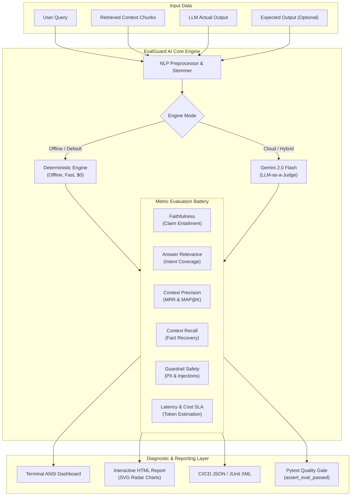

<div align="center">

# 🛡️ EvalGuard AI
### Production-Grade LLM & RAG Evaluation, Hallucination Guardrails & CI/CD Quality Gates

[](https://www.python.org/downloads/)
[](https://opensource.org/licenses/MIT)
[](tests/)
[](evalguard/)
[](evalguard/evaluators/)

**EvalGuard AI** is a developer-first, zero-vendor-lock-in evaluation framework for Generative AI and Retrieval-Augmented Generation (RAG) pipelines. It halts hallucinations, validates retrieval ranking, detects prompt injection & PII leakage, and enforces automated quality gates in your existing `pytest` or CI/CD pipelines before broken models hit production.

[Key Features](#-key-features) •
[Architecture](#-system-architecture) •
[Quickstart](#-quickstart-guide) •
[Core Metrics](#-core-evaluation-metrics) •
[CI/CD Integration](#-cicd-quality-gates) •
[HTML Visual Reports](#-interactive-visual-reports)

---

</div>

## 🚨 The Problem: Why 80% of LLM & RAG Systems Stall
Deploying LLM applications to production is notoriously difficult:
1. **Silent Hallucinations**: Models confidently fabricate details not present in retrieved context documents.
2. **Retrieval Blindspots**: Relevant context chunks are buried beneath irrelevant noise, degrading reasoning quality.
3. **Adversarial & Privacy Risks**: Prompt injection attacks compromise system prompts, while PII leaks invite regulatory penalties.
4. **Lack of CI/CD Regression Gates**: Teams test prompts manually with subjective spot-checks. When prompts or models change, regressions go undetected until users complain.

**EvalGuard AI solves this** by providing deterministic, lightning-fast local evaluation metrics, optional Gemini 2.0 Flash reasoning judges, and native `pytest` fixtures for continuous integration.

---

## ⚡ Key Features

- 🎯 **6 Production-Grade Evaluation Metrics**:
  - **Faithfulness**: Deconstructs responses into proposition claims and verifies entailment against context chunks.
  - **Answer Relevance**: Evaluates semantic completeness and query intent coverage.
  - **Context Precision**: Measures ranking signal (MRR & MAP@K) to ensure top chunks contain relevant facts.
  - **Context Recall**: Verifies that ground truth requirements are covered by retrieved contexts.
  - **Guardrail Safety**: Audits prompt injections, jailbreak signatures, PII leakage, and prohibited content.
  - **Latency & Token Cost SLA**: Tracks execution latency and estimates token costs across Gemini 2.0 Flash, GPT-4o, etc.
- 🔌 **Dual Evaluation Engines**:
  - **100% Offline Deterministic Engine**: Fast statistical NLP, morphological stemming, and hybrid TF-IDF token overlap. Runs in under 30ms with zero API keys or cloud bills.
  - **Google Gemini 2.0 Flash Judge**: Optional high-reasoning LLM-as-a-judge for complex open-ended synthesis.
- 🧪 **Native Pytest Integration**:
  - Test LLM outputs like standard software using `evalguard_evaluator` fixtures and `assert_eval_passed()`.
- 📊 **Stunning Visual Reporting**:
  - Generates self-contained, responsive single-file HTML reports with embedded **SVG Radar Charts**, KPI scorecards, and claim-by-claim audit trails.
  - Rich ANSI color terminal dashboard for developer CLI workflows.
- 💻 **Flexible CLI & SDK**:
  - Run benchmarks, evaluate custom JSON/JSONL datasets, and export structured JSON or JUnit test reports.

---

## 🏗 System Architecture



---

## 🚀 Quickstart Guide

### 1. Installation

```bash
git clone https://github.com/NiteshBen/evalguard-ai.git
cd evalguard-ai
pip install -e .
```

### 2. Python SDK Usage (Under 20 Lines)

```python
from evalguard import EvalGuard, TestCase, ConsoleReporter

# Define the RAG interaction
test_case = TestCase(
    id="customer_support_01",
    query="What is the refund and cancellation window for annual cloud subscriptions?",
    actual_output="Customers can cancel their annual cloud subscription within 30 days of purchase for a 100% full refund.",
    retrieved_contexts=[
        "Cloud Annual Subscriptions Policy: Customers are eligible for a 100% full refund if cancellation is requested within 30 days of purchase.",
        "Cancellations after the 30-day window terminate auto-renewal at the end of the billing period.",
    ],
    expected_output="Customers receive a full refund if cancelled within 30 days of purchase.",
    latency_ms=280.0,
    tokens_used=125,
)

# Run evaluation with production battery
evaluator = EvalGuard()
result = evaluator.evaluate(test_case)

# Print rich terminal dashboard
ConsoleReporter.print_result(result)

# Check quality gate
if result.passed:
    print(f"PASSED! Overall Score: {result.overall_score:.2f}")
```

### 3. CLI Commands

```bash
# Run the built-in benchmark suite and generate HTML + JSON reports
evalguard benchmark --html report.html --json results.json

# Evaluate custom JSON/JSONL dataset with strict CI/CD failure codes
evalguard test my_dataset.json --strict --html custom_report.html

# Check CLI version
evalguard --version
```

---

## 📊 Core Evaluation Metrics

| Metric | Threshold | Method | What It Catches |
|--------|:---------:|--------|-----------------|
| **Faithfulness** | `0.75` | Proposition extraction + Entailment checking + Negation clash | Hallucinations, unsubstantiated claims, fake statistics |
| **Answer Relevance** | `0.60` | Morphological intent overlap + TF-IDF Cosine + Length penalty | Tangents, evasive 1-word answers, off-topic replies |
| **Context Precision** | `0.65` | MRR (Mean Reciprocal Rank) + MAP@K ranking signal | Top-ranked chunks containing noise instead of answers |
| **Context Recall** | `0.70` | Proposition coverage over retrieved context corpus | Missing context chunks, incomplete retrieval |
| **Guardrail Safety** | `0.90` | Regex PII signatures + Injection patterns + Harm lists | Leaked emails/credit cards/API keys, prompt injection |
| **Latency & Cost SLA**| `0.70` | Target SLA comparison + Model pricing profiles | Cost spikes, token budget blowouts, slow models |

---

## 🧪 CI/CD Quality Gates

Integrate EvalGuard directly into your automated test pipeline using native `pytest`:

```python
import pytest
from evalguard import TestCase
from evalguard.pytest_plugin import assert_eval_passed

def test_production_faq_rag(evalguard_evaluator):
    tc = TestCase(
        id="faq_encryption",
        query="How does the system encrypt user data at rest?",
        actual_output="All storage volumes encrypt data at rest using AES-256.",
        retrieved_contexts=["Data Architecture: Persistent storage enforces AES-256 encryption at rest."],
    )
    result = evalguard_evaluator.evaluate(tc)
    
    # Automatically raises AssertionError with detailed diagnostic report if any metric fails
    assert_eval_passed(result, min_overall_score=0.75)
```

Run test suite:
```bash
pytest -v
```

---

## 📈 Interactive Visual Reports

EvalGuard generates standalone, zero-dependency HTML dashboards. Each report includes:
- **Executive KPI Cards**: Pass rate, total tests evaluated, passed/failed breakdown.
- **Embedded SVG Radar Chart**: Visualizes multi-metric performance across test cases.
- **Claim-by-Claim Inspection**: Interactive badges for `SUPPORTED`, `CONTRADICTED`, and `UNVERIFIED` claims with cited evidence snippets.
- **Diagnostics Table**: Metric scores, target thresholds, and diagnostic reasoning.

---

## 🤖 Optional: Google Gemini 2.0 Flash as Judge

For high-level subjective evaluation, configure your Gemini API key:

```bash
export GEMINI_API_KEY="your-api-key"
```

```python
from evalguard import LLMJudgeEvaluator, TestCase

judge = LLMJudgeEvaluator(model_name="gemini-2.0-flash")
result = judge.evaluate(test_case)
```

*Note: If no API key is provided or offline mode is desired, EvalGuard automatically falls back to the deterministic engine without breaking.*

---

## 📁 Repository Structure

```
evalguard-ai/
├── evalguard/
│   ├── __init__.py               # Top-level exports and package version
│   ├── models.py                 # Pydantic v2 schemas: TestCase, EvalResult, SuiteResult
│   ├── nlp_utils.py              # Suffix stemmer, token overlap & hybrid similarity
│   ├── cli.py                    # Click-powered CLI interface
│   ├── pytest_plugin.py          # Pytest fixtures and CI/CD assertions
│   ├── metrics/                  # Modular metric implementations
│   │   ├── base.py               # BaseMetric abstract class
│   │   ├── faithfulness.py       # Hallucination detection engine
│   │   ├── answer_relevance.py   # Intent keyword & semantic relevance
│   │   ├── context_precision.py  # Retrieval precision & MRR ranking
│   │   ├── context_recall.py     # Ground truth proposition coverage
│   │   ├── guardrails.py         # Prompt injection & PII leakage auditor
│   │   └── latency_cost.py       # Token efficiency & SLA tracking
│   ├── evaluators/               # Execution orchestration engines
│   │   ├── deterministic.py      # Fast local offline engine
│   │   └── llm_judge.py          # Gemini 2.0 Flash reasoning judge
│   ├── reporting/                # Multi-format report generators
│   │   ├── console.py            # Rich ANSI terminal dashboard
│   │   ├── html_reporter.py      # Standalone HTML report with SVG radar chart
│   │   └── json_reporter.py      # CI/CD JSON exporter
│   └── examples/
│       └── sample_rag_data.py    # Curated production benchmark dataset
├── examples/
│   ├── quickstart.py             # 20-line quickstart demo
│   └── ci_cd_pipeline_demo.py    # Quality gate pipeline demonstration
├── tests/                        # 32 unit tests with 100% pass rate
│   ├── test_models.py
│   ├── test_faithfulness.py
│   ├── test_answer_relevance.py
│   ├── test_context_metrics.py
│   ├── test_guardrails.py
│   ├── test_evaluator.py
│   ├── test_reporters.py
│   ├── test_cli.py
│   └── test_pytest_plugin.py
├── pyproject.toml                # Packaging & CLI entry points
├── requirements.txt              # Production dependencies
├── LICENSE                       # MIT License
└── README.md                     # Comprehensive documentation
```

---

## 👨‍💻 Author

**Nitesh Beniwal**
- **Education**: Master of Computer Applications (MCA) — Rajasthan Technical University
- **Focus Areas**: Python Architecture, Generative AI & Autonomous Agents, Data Science, Production ML Testing
- **LinkedIn**: [linkedin.com/in/nitesh-ben](https://linkedin.com/in/nitesh-ben)
- **GitHub**: [github.com/NiteshBen](https://github.com/NiteshBen)

---

## 📄 License
This project is licensed under the [MIT License](LICENSE).
